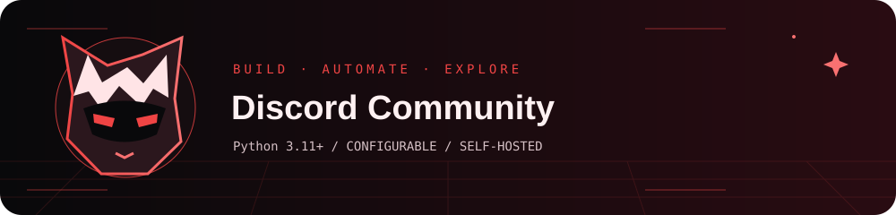

# Discord Community

An AION 2 community bot for private guild areas, opt-in roles, events, party recruitment and character profiles.

**Runtime:** Python 3.11+ · **Configuration:** environment variables · **Deployment:** self-hosted

## Quick start

The supported deployment target is Linux. Create an isolated Python environment:

```sh
python3 -m venv venv
. venv/bin/activate
python -m pip install -r requirements.txt
cp .env.example .env
# Edit .env first. Use shell-compatible quoting for JSON and values with spaces.
set -a
. ./.env
set +a
python bot.py
```

Only source a configuration file you created and trust. Starting the application can connect to external services; configure credentials and destinations first.

## Usage

Run `/help` after inviting the bot with the `bot` and `applications.commands` scopes. Administrators can use `/setupserver`; guild leaders can manage membership within their own guild. `/resetserver` deletes channels, messages and custom roles: use it only when deliberately rebuilding a server.

## Command groups

| Command | Purpose |
| --- | --- |
| `/setupserver` | Create or reconcile the Basic Global layout and settings |
| `/serversettings` | Owner: reapply ordinary entry and community permissions |
| `/resetserver` | Owner: ERASE all channels/messages and custom roles; rebuild Basic |
| `/setupguild` | Leader: create your own private guild area; admins can reconcile guilds |
| `/guildmember` | Leader: assign Officer or Member in your own guild |
| `/guildremove` | Leader: remove ordinary members from your own guild |
| `/lfg` | Create a party with Join, Leave and Reserve buttons |
| `/event` | Schedule a Global event with signup and opt-in reminders |
| `/resetclock` | Admin: configure a verified UTC reset schedule for checklists |
| `/craft` | Publish a material or crafting help request |
| `/bossreport` | Report a sighting or kill; this is a player report, not a prediction |
| `/guidecard` | Admin: publish a sourced, versioned guide or official news |
| `/alert` | Publish an admin announcement or a Leader announcement inside your own guild |
| `/resources` | Useful official links, maps and build tools |
| `/report` | Send a private report to server moderators |
| `/botchannel` | Admin: choose where bot posts are published |
| `/help` | How to use the AION 2 community bot |

Discord provides subcommands and argument descriptions when you type a command.

## Configuration

`.env.example` contains placeholders only. Real credentials, IDs, storage locations and account settings belong in your private local configuration.

| Variable | Requirement |
| --- | --- |
| `AION_DATA_PATH` | Path to the community SQLite database. |
| `DISCORD_GUILD_ID` | Discord guild in which to register commands. |
| `DISCORD_TOKEN` | Discord bot token; keep it secret. |

## How it works and operational notes

The SQLite database stores guild configuration, profiles, signups and permissions. Keep `data/` private and back it up. The bot needs permissions appropriate to the commands you use, including managing roles and channels for setup. Its highest role must be above roles it manages.

## Project layout

- Source files implement the application and integrations.
- `requirements.txt` or the project file declares dependencies.
- `.env.example` documents configuration names without live values.
- `.gitignore` excludes credentials, sessions, generated data and build output.
- `assets/banner.svg` is an original animated vector illustration. It has a static fallback and respects reduced-motion preferences in supporting viewers.

## Verification

See [VALIDATION.md](VALIDATION.md) for the checks performed on this publication snapshot and the remaining deployment checks. A source check is not an end-to-end test of Discord, Telegram, music sites or your host.

## Privacy and upstream services

This repository is a configurable source distribution. It does not include a production database, personal saved-link collection, message archive, credentials, media library or existing Git history. Review local changes before committing them.

Third-party APIs, libraries and products remain the work of their respective maintainers. Review their terms and licenses before redistribution or deployment. The original project artwork is stored locally; it does not depend on a remote GIF or tracking service.
